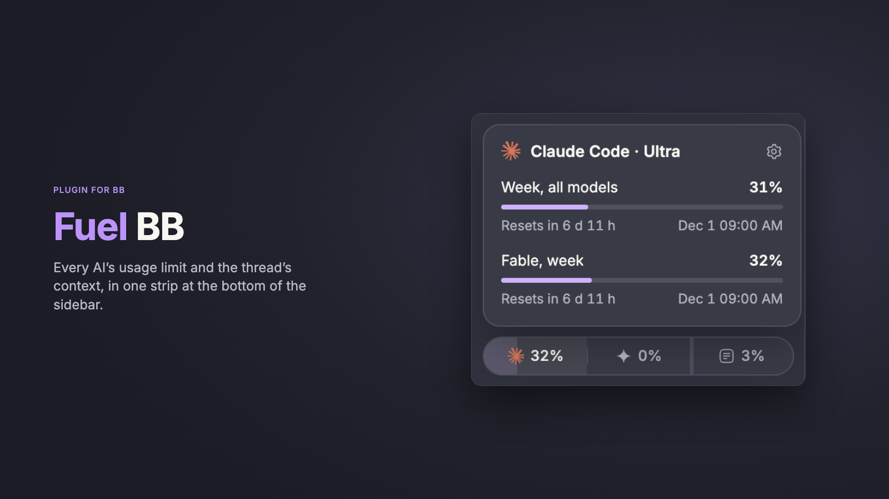
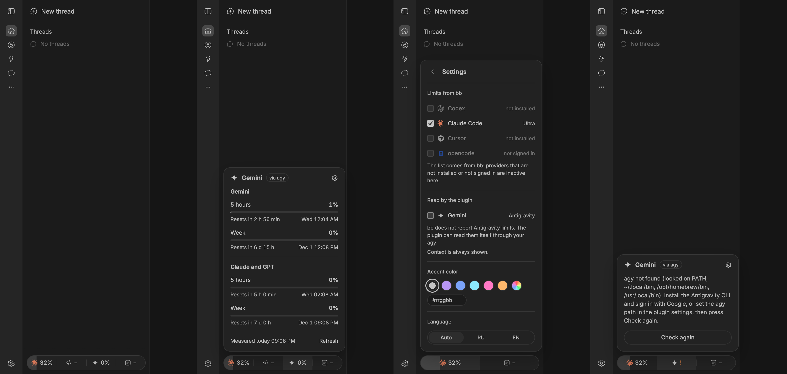

# Fuel BB for bb



A strip in the bb sidebar footer: one button per agent provider with the share of its
limit already used, plus the open thread's context fill. A click opens the details:
every limit window, time to reset and, with the
[Usage Forecast](https://github.com/ponomr/bb-plugin-usage-forecast) plugin, whether
the window lasts until the reset. The Context popover compacts the thread after a
confirmation.

Plugin id: `fuel-bb`.



## Providers

Buttons are built from what bb itself reports in its usage limits
(`bb settings usage`): Claude Code, Kimi Code, Cursor, OpenCode and any provider a
future bb adds. A provider that is not installed or not signed in gets no button.
The gear in any popover lists every provider bb found, with a checkbox to hide it.

- **Kimi Code.** When bb has no Kimi usage (its provider is not signed in) but the
  kimi CLI is, the plugin reads `GET <base_url>/usages` with the CLI's own token
  from `~/.kimi-code`. It never refreshes or copies that token.
- **Gemini (Antigravity).** bb does not report Antigravity limits. The plugin can
  read them itself through the `agy` CLI (`agy -p /usage`, no model request), only while
  Gemini is in use: every 5 minutes while an Antigravity thread works, once right after its
  turn, and when you open the Gemini popover on a measurement older than 2 minutes; plus a
  background check (setting *Gemini background check*: off, every 30 minutes by default, or once
  an hour) for quota spent outside bb. The popover always shows when it was measured. If agy
  does not answer, the plugin falls back to Google's quota endpoint with agy's token from the
  macOS Keychain.
  macOS only. It is off until you tick Gemini under *Read by the plugin* in the
  settings; the strip then shows `···` during the first read and `!` with a hint
  when agy is missing or not signed in.

## Antigravity account switching (off by default)

Settings → Installed plugins → Fuel BB → *Antigravity account switching*.
When on, the Gemini popover lists saved Antigravity accounts with Switch, Forget and
Add account. What it touches:

- agy keeps its Google sign-in (access and refresh tokens, email) in the macOS
  Keychain item `gemini` / `antigravity`. The plugin copies it into its own Keychain
  items (service `limits-panel-gemini-accounts`) and puts a copy back on switch.
- Plugin storage keeps only account ids, labels and emails. Tokens never go to logs,
  disk or plugin storage.
- Add account temporarily removes the current sign-in (a copy is kept) and opens
  `agy` in a bb terminal for a Google sign-in.
- After a switch, idle Antigravity threads are stopped at once and answering ones
  when they finish, so their next turn uses the new account.

When the setting is off the plugin does not read or write these Keychain items.

## Settings

In the popover gear: strip buttons (bb's providers, and Gemini under "Read by the
plugin"), account switching, accent color and language (auto, English, Russian).

**Accent.** By default the strip uses the shared accent: the sidebar color from the
[Folio BB](https://github.com/xaibu9/bb-plugin-folio) plugin
(`--folio-accent`) when it is installed, otherwise the bb theme accent.
Change the color in Folio BB and the strip follows at once. A circle picked
here overrides it for the strip only. In Settings → Installed plugins: account
switching, the Gemini background check (off, every 30 minutes, once an hour) and the path
to `agy` (empty: look on `PATH` and in `~/.local/bin`,
`/opt/homebrew/bin`, `/usr/local/bin`).

## CLI

```sh
bb fuel status [--refresh] [--json]
bb fuel thread <threadId> [--json]
bb fuel accounts | save-account [label] | switch-account <id|next> | remove-account <id>
```

The account commands need account switching on.

## Testing

`npm run e2e` starts a separate, throwaway bb (its own data folder and ports,
bundled plugins only), installs a copy of this plugin and checks the empty state,
Gemini without agy, Kimi and agy as signed in on the machine, and the shared accent
with Folio BB (`FOLIO_DIR`, default `../bb-plugin-sidebar-pack`). It
needs bb.app and Google Chrome, stops the instance and deletes its files at the end;
screenshots land in `e2e/out/`.

## Install

```sh
bb plugin install https://github.com/xaibu9/bb-plugin-fuel.git
```

From a checkout: `npm install && bb plugin build && bb plugin install . --yes`.
